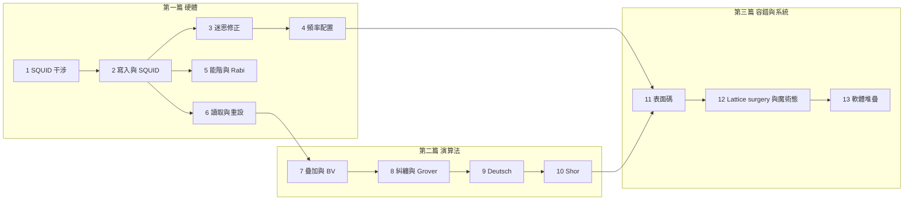

# 超導量子電腦：從 SQUID 到軟體堆疊——師生對話教學紀錄

> 本文件把一次完整的討論課整理成「老師／學生」的對話紀錄，供日後教學使用。
> - **👩‍🏫 老師**：Claude（回答、修正觀念、做動畫）
> - **🧑‍🎓 學生**：提問者（從 SQUID 一路問到軟體堆疊）
>
> 對話內容依主題重新編排成 3 篇、13 課；原始提問的先後順序見[附錄 E](#附錄-e原始提問時間序)。每一課都附上可以直接開啟的 3D 互動動畫（[`animations/transmon-3d.html`](../animations/transmon-3d.html)，共 12 章）。

---

## 目錄

- [怎麼使用這份紀錄](#怎麼使用這份紀錄)
- [課程地圖](#課程地圖)
- **第一篇　硬體：量子位元是怎麼做出來的**
  - [第 1 課　SQUID 干涉之後能做什麼](#第-1-課squid-干涉之後能做什麼)
  - [第 2 課　Transmon 怎麼寫入狀態？SQUID 的角色](#第-2-課transmon-怎麼寫入狀態squid-的角色)
  - [第 3 課　迷思修正：Z 線不是把位元調成「一樣」](#第-3-課迷思修正z-線不是把位元調成一樣)
  - [第 4 課　頻率配置與頻率碰撞](#第-4-課頻率配置與頻率碰撞)
  - [第 5 課　能階、共振與 Rabi 振盪：沒有 JJ 會怎樣](#第-5-課能階共振與-rabi-振盪沒有-jj-會怎樣)
  - [第 6 課　色散讀取與重設](#第-6-課色散讀取與重設)
- **第二篇　演算法：量子位元是怎麼計算的**
  - [第 7 課　T₁、shot 與疊加態的用途：Bernstein–Vazirani](#第-7-課tshot-與疊加態的用途bernsteinvazirani)
  - [第 8 課　糾纏與兩位元 Grover](#第-8-課糾纏與兩位元-grover)
  - [第 9 課　Deutsch 演算法與相位回踢](#第-9-課deutsch-演算法與相位回踢)
  - [第 10 課　Shor 演算法](#第-10-課shor-演算法)
- **第三篇　容錯與系統：從實驗品到電腦**
  - [第 11 課　量子錯誤更正：表面碼](#第-11-課量子錯誤更正表面碼)
  - [第 12 課　Lattice surgery 與魔術態蒸餾](#第-12-課lattice-surgery-與魔術態蒸餾)
  - [第 13 課　編譯與控制軟體堆疊](#第-13-課編譯與控制軟體堆疊)
- 附錄
  - [附錄 A　動畫章節對照](#附錄-a動畫章節對照)
  - [附錄 B　關鍵數字速查](#附錄-b關鍵數字速查)
  - [附錄 C　術語表](#附錄-c術語表)
  - [附錄 D　學生迷思總整理](#附錄-d學生迷思總整理)
  - [附錄 E　原始提問時間序](#附錄-e原始提問時間序)

---

## 怎麼使用這份紀錄

| 用途 | 建議用法 |
|---|---|
| **自學** | 先讀「學生提問」，自己想一下再看老師的回答；最後做「課後練習」，答案收在摺疊區塊裡 |
| **上課** | 每課約 30–50 分鐘：先播放對應動畫的導覽步驟，再用對話引導討論，最後讓學生操作「自由實驗」 |
| **出題** | 「學生的理解 → 老師的修正」段落可以直接改成是非題或改錯題（見[附錄 D](#附錄-d學生迷思總整理)） |

**每一課的固定結構：**
1. 🎯 學習目標
2. 💬 師生對話（依原始討論整理，保留學生的原始問法）
3. 📌 重點整理
4. 🎬 動畫演示（直接點連結開啟；需連網載入 three.js）
5. ✏️ 課後練習

**貫穿全課的範例參數**（與動畫一致）：

| 參數 | 數值 |
|---|---|
| 位元頻率 f₀₁ | 5.21 GHz |
| 非諧性 α | 約 −283 MHz（1→2 為 4.93 GHz） |
| E_J／E_C | 15 GHz／250 MHz（比值 60） |
| 十字電容 C_Σ | 約 77.5 fF |
| 讀取共振腔 | 約 7 GHz |
| 色散偏移 χ | 約 0.77 MHz（κ ≈ 2χ） |
| T₁ | 約 100 μs |

---

## 課程地圖



| 課 | 主題 | 學生的核心問題 | 對應動畫 | 建議時數 |
|---|---|---|---|---|
| 1 | SQUID 干涉 | 兩個 JJ 的電流干涉之後能做什麼？ | 第 1 章 晶片 | 30 分 |
| 2 | 寫入與 SQUID | Transmon 怎麼寫入？SQUID 做什麼？ | 第 1、4 章 | 40 分 |
| 3 | 迷思修正 | 控制好 Z 就能得到一樣的位元？ | 第 6 章 案例 | 30 分 |
| 4 | 頻率配置 | 頻率要怎麼排？什麼叫碰撞？ | 第 6 章 案例 | 50 分 |
| 5 | 能階與 Rabi | 沒有 JJ 會怎樣？Rabi 振盪就是疊加嗎？ | 第 3、4 章 | 50 分 |
| 6 | 讀取與重設 | 讀取原理？讀完要重新降溫嗎？ | 第 5 章 讀取 | 50 分 |
| 7 | 疊加與 BV | 疊加態要做什麼？怎麼計算？ | 第 9 章 BV 密碼 | 40 分 |
| 8 | 糾纏與 Grover | 糾纏是什麼？兩位元 Grover 怎麼跑？ | 第 7 章 振幅長條 | 50 分 |
| 9 | Deutsch | 第一個量子演算法在做什麼？ | 第 7 章（`#deutsch`） | 30 分 |
| 10 | Shor | 為什麼能分解大數？ | 第 8 章 Shor | 60 分 |
| 11 | 表面碼 | 量子錯誤怎麼抓、怎麼修？ | 第 10 章 表面碼 | 60 分 |
| 12 | 邏輯閘 | 受保護的位元怎麼做運算？ | 第 11 章 邏輯閘 | 50 分 |
| 13 | 軟體堆疊 | 一行程式怎麼變成微波脈衝？ | 第 12 章 軟體堆疊 | 50 分 |

---

# 第一篇　硬體：量子位元是怎麼做出來的

## 第 1 課　SQUID 干涉之後能做什麼

### 🎯 學習目標
- 說出 SQUID 的控制旋鈕是**磁通 Φ**，不是直接改電流相位
- 寫出 I_c(Φ) = 2I_c₀|cos(πΦ/Φ₀)|，並說明週期是一個磁通量子 Φ₀
- 列舉 SQUID 的三大類用途：量磁場、調參數、當量子位元本身

### 💬 師生對話

> **🧑‍🎓 學生：** 用 SQUID 架構改變兩個 JJ 的電流相位後，兩個電流產生干涉，然後可以做啥？

**👩‍🏫 老師：** SQUID 干涉之後，最直接得到的是一顆**用磁通就能調整臨界電流的「可調 JJ」**。其他用途都從這一點延伸。

先修正一個小觀念：不是「直接改變兩個 JJ 的電流相位」。比較精確的說法是——
1. 超導體裡的 Cooper pair 共用一個巨觀波函數 ψ = |ψ|e^{iθ}。
2. 電流從左邊進來，分成兩條路，各穿過一個 JJ，再在右邊匯合，很像**雙狹縫干涉**。
3. 外加磁通 Φ 穿過迴路時，兩條路徑累積不同的相位（類似 Aharonov–Bohm 效應），再加上磁通量子化，兩個 JJ 的相位差被綁成 **φ₁ − φ₂ = 2πΦ/Φ₀**（Φ₀ = h/2e ≈ 2.07×10⁻¹⁵ Wb）。
4. 兩路超電流疊加後，SQUID 能承載的最大超電流是 **I_c(Φ) = 2I_c₀|cos(πΦ/Φ₀)|**。

所以你能控制的旋鈕是**磁通 Φ**；干涉的結果表現為**臨界電流隨 Φ 週期變化**。

**干涉之後能做什麼：**

| 用途 | 怎麼用干涉 | 例子 |
|---|---|---|
| ① 極靈敏磁通偵測器 | 磁通 → 電壓，配合磁通鎖定迴路線性化；靈敏度約 10⁻⁶ Φ₀/√Hz（fT 等級） | 腦磁圖、心磁圖、MPMS、SQUID 掃描顯微鏡 |
| ② 可調頻率 transmon | E_J 變成 E_J(Φ)，f₀₁ ≈ √(8E_J E_C) − E_C 隨 Z 線調整 | 閃開 TLS 缺陷、做 CZ 閘（Google 路線） |
| ③ 可調耦合器 | 調耦合器頻率，把兩位元之間的耦合（含寄生 ZZ）開到大或關到近 0 | 大型超導晶片壓串擾 |
| ④ JPA／TWPA 放大器 | SQUID 當諧振腔末端，2ω 磁通 pump 做參數放大 | 讀取鏈第一級放大，接近量子極限 |
| ⑤ rf-SQUID 量子位元 | 迴路磁通本身當位元 | flux qubit、fluxonium、D-Wave 退火機 |
| ⑥ 超導數位邏輯 | 單一磁通量子當位元 | SFQ／RSFQ 低溫控制電子 |

可調 transmon 的代價：磁通雜訊會變成頻率抖動（dephasing）。對策是**待在 sweet spot**（Φ = 0，df/dΦ = 0），或用**不對稱 SQUID**（調頻範圍變小，但整段對雜訊較不敏感）。

### 📌 重點整理
> **SQUID 用量子干涉，把「磁通」轉換成「臨界電流（也就是 E_J 和電感）」。** 把磁通讀出來 → 磁力計；用磁通調參數 → 可調 transmon、耦合器、JPA；讓迴路磁通承載資訊 → flux qubit、量子退火。

### 🎬 動畫演示
- [第 1 章 晶片](../animations/transmon-3d.html#chip)：找到十字下端的兩個橘色 JJ（SQUID 迴路）與右下角的 Z 線。

### ✏️ 課後練習
1. SQUID 的 I_c 每變化一個週期，迴路中的磁通改變多少？
2. 為什麼可調 transmon 平常要停在 Φ = 0？
3. 不對稱 SQUID 犧牲了什麼、換到什麼？

<details><summary>參考答案</summary>

1. 一個磁通量子 Φ₀ = h/2e ≈ 2.07×10⁻¹⁵ Wb。
2. Φ = 0 時 df/dΦ = 0，對磁通雜訊一階不敏感，dephasing 最小（sweet spot）。
3. 犧牲可調範圍，換到整段調頻曲線對磁通雜訊都比較不敏感。
</details>

---

## 第 2 課　Transmon 怎麼寫入狀態？SQUID 的角色

### 🎯 學習目標
- 對照晶片圖說出：十字電容、SQUID、XY 線、Z 線、讀取腔各自的工作
- 說明「寫入」= 從 |0⟩ 出發，用 XY 微波脈衝旋轉狀態；脈衝面積、相位、頻率各控制什麼
- 解釋為什麼 5.21 GHz 的微波只會停在 |1⟩，不會衝上 |2⟩（非諧性）
- 說出 SQUID 的兩個身分：非線性電感、頻率旋鈕

### 💬 師生對話

> **🧑‍🎓 學生：** 再延伸問一下，那 transmon 是怎麼寫入狀態的？SQUID 作用是？你用這張圖解釋清楚（之前你做的模型）。*（附上第 1 章晶片俯視圖）*

**👩‍🏫 老師：** 先看圖上的分工：

| 圖上位置 | 元件 | 角色 |
|---|---|---|
| 中央 | 十字電容板 C_Σ（≈ 77.5 fF） | 儲存電荷，提供充電能 E_C |
| 十字下端兩個小方塊 | SQUID（兩個 JJ 圍成迴路） | 非線性電感，提供 E_J；也是頻率旋鈕 |
| 左下 | XY 驅動線 | **寫入**：送 f₀₁ 的微波脈衝 |
| 右下 | Z 磁通線 | **調頻率**：電流產生磁通穿過 SQUID |
| 上方 | 讀取共振腔（約 7 GHz）＋饋線 | 讀出狀態 |

重點：**SQUID 不負責寫入，XY 線才負責寫入。**

**一、怎麼寫入**
- **Step 0：一律從 |0⟩ 開始。** 晶片在 10–20 mK，熱能約 0.2–0.4 GHz，遠小於 5.21 GHz，靜置後 > 99% 在 |0⟩。不想等，就先量一次、量到 1 補一個 π 脈衝（主動重設）。
- **Step 1：XY 線送 f₀₁ 的微波脈衝。** XY 線末端開路、靠電容耦合到十字（沒有接上去）。頻率等於 f₀₁ 時共振，|0⟩、|1⟩ 之間發生 Rabi 振盪，也就是布洛赫球上的旋轉。

| 脈衝參數 | 控制 | 例子 |
|---|---|---|
| 振幅 × 時間（面積） | 旋轉**角度** | π 脈衝：\|0⟩→\|1⟩；π/2：\|0⟩→(\|0⟩+\|1⟩)/√2 |
| 微波**相位** | 繞**哪一軸** | 0° 繞 X、90° 繞 Y |
| **頻率** | 選**哪一對能階** | 5.21 GHz 只驅動 0↔1 |

任意疊加態都由幾個不同角度、不同軸的旋轉組合出來。

- **為什麼只到 |1⟩？JJ 的功勞。** 普通電感 → 能階等距 → 微波一路往上推。換成 JJ，位能變 cos 井，0→1 是 5.21 GHz、1→2 低了 283 MHz，所以 5.21 GHz 只作用在 0↔1（非諧性）。脈衝通常 20–50 ns，並用 **DRAG** 整形抑制漏到 |2⟩。
- **XY 線為什麼不貼緊？** 耦合太強，位元的能量會反過來漏進 XY 線，T₁ 變短。

**二、SQUID 的兩個身分**
1. **非線性電感**：C_Σ ＋ L_J 構成非線性 LC。f₀₁ ≈ √(8 × 15 × 0.25) − 0.25 ≈ 5.2 GHz。E_J/E_C = 60，落在 transmon 區：電荷雜訊可忽略，同時保有約 280 MHz 非諧性。**這個身分單一 JJ 也做得到**（IBM 固定頻率位元）。
2. **頻率旋鈕**：兩個 JJ 圍成迴路，Z 線的磁通（電感耦合，和 XY 的電容耦合不同）讓 E_J(Φ) = E_J,max|cos(πΦ/Φ₀)|。

| Z 線磁通 | E_J/h | f₀₁（約） |
|---|---|---|
| Φ = 0（sweet spot） | 15 GHz | 5.21 GHz |
| 0.1 Φ₀ | 14.3 GHz | 降約 130 MHz |
| 0.25 Φ₀ | 10.6 GHz | 約 4.4 GHz |

Z 線拿來：設定工作點（修正製程誤差、避開 TLS 與鄰居）、做 Z 旋轉（實務上多用**虛擬 Z**：軟體改後續脈衝相位，0 ns、0 誤差）、做 **CZ 閘**（快速磁通脈衝讓 |11⟩ 與 |20⟩ 共振繞一圈得到 −1）、讀取時移開。

### 📌 重點整理
> **十字電容 ＋ SQUID 造出能階不等距的人造原子；Z 線透過 SQUID 決定它的頻率；XY 線用該頻率的微波脈衝把狀態從 |0⟩ 轉到想要的位置（寫入）；讀取共振腔再把結果讀出來。**

### 🎬 動畫演示
- [第 1 章 晶片](../animations/transmon-3d.html#chip)：按「送出 π 脈衝」，十字板發光代表進入 |1⟩，再依 T₁ 衰減。
- [第 4 章 操控](../animations/transmon-3d.html#control)：布洛赫球上比較 X 軸、Y 軸的 π/2 與 π 旋轉。

### ✏️ 課後練習
1. 要把 |0⟩ 寫成 (|0⟩+|1⟩)/√2，要調整脈衝的哪個參數？
2. XY 線和 Z 線分別用電場還是磁場耦合到位元？
3. 為什麼 IBM 的位元不需要 SQUID 也能當量子位元？

<details><summary>參考答案</summary>

1. 脈衝面積（振幅 × 時間）做成 π/2；相位決定繞 X 或 Y 軸（兩者機率都 50/50，但相位不同）。
2. XY：電容耦合（電場）；Z：電感耦合（磁場，磁通穿過 SQUID 迴路）。
3. 單一 JJ 就能提供非線性電感（非諧性），只是頻率固定、不能調。
</details>

---

## 第 3 課　迷思修正：Z 線不是把位元調成「一樣」

### 🎯 學習目標
- 修正「XY 讓電路變成量子位元」的因果顛倒
- 說出 Z 線（SQUID）能調與不能調的特性
- 理解為什麼頻率要**錯開**而不是調成一樣

### 💬 師生對話

> **🧑‍🎓 學生：** 你的意思是說～我用 XY 驅動線寫入我要的量子狀態，讓十字電容跟 JJ 來回振盪（變成量子位元），然後 SQUID 是用來修正製程差異用的！只要控制好 Z，我就可以得到數個特性接近的量子位元？

**👩‍🏫 老師：** 大方向對，但有三處要修正，第三點最重要：**實務上不會把位元調成「特性一樣」，反而刻意排在不同頻率。**

| 學生的理解 | 判斷 | 修正 |
|---|---|---|
| 用 XY 寫入想要的狀態 | ✅ | 從 \|0⟩ 出發，面積定角度、相位定軸 |
| XY 讓電路來回振盪「變成」量子位元 | ⚠️ 因果顛倒 | 十字電容＋JJ **本來就是**量子位元，XY 只是**改變它的狀態** |
| SQUID 用來修正製程差異 | ⚠️ 只對一半 | 還有閃避 TLS、做 CZ 閘；而且只能**往下調** |
| 控制好 Z 就得到特性接近的位元 | ❌ 方向相反 | Z 只能調**頻率**；而且頻率要**錯開** |

**修正一：** 晶片冷下來後，電路就已經有一組不等距能階、待在 |0⟩。「來回振盪」比較精確的說法是：疊加態裡電荷以 f₀₁ 在十字板與接地之間經過 JJ 來回流動。

**修正二：** SQUID 的用途有：修製程誤差（JJ 氧化層差幾個原子，頻率可偏約 100 MHz）、閃避會飄移的 TLS、做 CZ。限制是**只能往下調**（最高在 Φ = 0），所以 E_J 要刻意做大一點；離 sweet spot 越遠 T₂ 越差。修製程也不一定要 SQUID：IBM 用**雷射退火**一次性修 JJ 電阻。

**修正三：Z 只能調一個參數。**

| 特性 | 由什麼決定 | Z 能調？ |
|---|---|---|
| 頻率 f₀₁ | E_J（SQUID）＋E_C | ✅ |
| 非諧性（≈ −E_C） | 十字電容幾何 | ❌ |
| T₁、T₂ | 材料、介面缺陷、雜訊 | ❌（每顆可差 2–3 倍） |
| 耦合強度 g | 電容幾何 | ❌ |
| 讀取腔頻率、χ | 共振腔設計 | ❌ |

而且**頻率一樣反而是災難**：相鄰同頻會共振交換能量（串擾），XY 脈衝也分不出要打哪一顆。所以要做**頻率配置**，平常各自停在不同頻率；要做雙位元閘時，才用 Z 脈衝短暫拉到共振。

> 樂團比喻：Z 是調音師，任務是把每把樂器調到**各自分配到的音**；要合奏（雙位元閘）時，指揮才讓兩把樂器短暫對上同一個音。

特性不一樣怎麼辦？**靠校準軟體逐顆處理**（每顆有自己的 π 振幅、DRAG、讀取門檻、CZ 參數）。「不一樣」不是問題，「**不穩定**」才是問題。

產業兩條路線：**可調頻率**（Google、祖沖之：彈性大、CZ 快）vs **固定頻率＋可調耦合器或微波閘**（IBM：穩定、線少）。Z 線的代價：磁通串擾、配線與熱負載、離開 sweet spot 的磁通雜訊。

### 📌 重點整理
> 十字電容＋JJ 本身就是量子位元；XY 改寫狀態；SQUID＋Z 線把每顆位元的頻率放到**各自指定的位置**（修製程、閃缺陷、短暫共振做 CZ）；其他特性調不了，靠校準逐顆處理。

### 🎬 動畫演示
- [第 6 章 案例](../animations/transmon-3d.html#case) 步驟 1–2：三顆位元頻率因製程散開又互撞；SQUID 調頻只能往下、離開 sweet spot 會抖動。

### ✏️ 課後練習
1. 判斷對錯：「只要每顆位元的 Z 線校準好，所有位元的 T₁ 就會一樣。」
2. 為什麼可調 transmon 的 E_J 設計值要刻意做大？
3. 列出 Z 線的三個代價。

<details><summary>參考答案</summary>

1. 錯。Z 只能調頻率；T₁ 由材料與缺陷決定。
2. SQUID 只能把頻率往下調，E_J 做大才有往下調的空間。
3. 磁通串擾（需補償矩陣）、配線與熱負載、離開 sweet spot 的磁通雜訊。
</details>

---

## 第 4 課　頻率配置與頻率碰撞

### 🎯 學習目標
- 說出限制頻率擺放的三個物理原因：驅動選擇性、耦合交換、多能階（隱藏頻率）
- 以 A = 5.21 GHz 算出鄰居 B 的五類禁區
- 理解為何棋盤格兩種頻率不夠（旁觀者碰撞），以及 heavy-hex 的取捨
- 比較固定頻率與可調頻率兩條路線的難處

### 💬 師生對話

> **🧑‍🎓 學生：** 好，繼續講頻率配置與頻率碰撞。

**👩‍🏫 老師：** 頻率配置要讓位元「該互動時能互動，不該互動時互不干擾」。難在每顆位元不只 0→1，還有 1→2、0→2 等**隱藏頻率**。

**三個物理限制**
1. **驅動選擇性**：20 ns 的 π 脈衝頻寬約 50 MHz，鄰居落在頻寬內就被誤打；相鄰位元要錯開數十到上百 MHz。
2. **耦合造成交換**：耦合 g 約數–20 MHz；失諧接近 0 就互換激發；即使不共振，也有**殘餘 ZZ**，在 Δ ≈ ±|α| 附近急劇放大。
3. **多能階**：A 的 0→1 = 5.21、1→2 = 4.93、0→2 雙光子 = 5.07 GHz。**任何一條撞上鄰居任何一條，就是碰撞。**

**以 A = 5.21 GHz 為例，B 的禁區：**

| 碰撞 | 條件 | B 的禁區 | 後果 |
|---|---|---|---|
| ① 同頻 | f_B ≈ f_A | ~5.21 | \|01⟩↔\|10⟩ 交換、打 A 也打到 B |
| ② A₀₁ 撞 B₁₂ | f_A ≈ f_B + α | ~5.49 | 洩漏到 \|2⟩、ZZ 暴增 |
| ③ B₀₁ 撞 A₁₂ | f_B ≈ f_A + α | ~4.93 | 同上，方向相反 |
| ④ 雙光子 | f_B ≈ f_A ± α/2 | ~5.07／~5.35 | 經雙光子把 B 推上 \|2⟩ |
| ⑤ 旁觀者 | A 的兩個鄰居太近，或 C 撞 B₁₂ | B ≈ C 等 | 對 A 做閘時 B、C 被拖下水 |

```
   4.93     5.07     5.21     5.35     5.49   GHz
    ✗        ✗        ✗        ✗        ✗
  B01=A12  雙光子    同頻    雙光子   A01=B12
```

禁區寬約 ±10–30 MHz。但也不能離太遠：固定頻率的 CR 閘希望 B 落在 A 的 0→1 和 1→2 之間（straddling regime）。所以**能用的區域是一條被切碎、又有上下限的窄帶**。

**2D 晶格：兩種頻率不夠。** 棋盤格 H/L 避開了 ①～④，但中間的 H 有四個同頻的 L 鄰居 → **旁觀者碰撞**。要把 L 再拆成幾組，變成**帶連續禁區的圖著色問題**。降低連接度最有效：IBM 的 **heavy-hex** 每顆最多 2–3 個鄰居，代價是部分演算法需要更多 SWAP（第 13 課會再看到）。

**兩條路線，兩種難法：**

| 面向 | 固定頻率（IBM） | 可調頻率（Google） |
|---|---|---|
| 碰撞何時決定 | 製造時，永久 | 執行時，可閃開 |
| 主要難題 | 製造良率：零碰撞機率隨條件數指數下降 | 高維最佳化（閒置頻率、交互頻率、移動路徑、讀取頻率）＋ TLS 漂移追蹤 |
| 主要工具 | heavy-hex、**LASIQ 雷射退火**（精度十幾 MHz） | Z 線、可調耦合器、**Snake** 最佳化器 |
| 代價 | 頻率精度要求極高 | 磁通雜訊、配線多、校準複雜 |

可調耦合器把 g 關到近 0，鬆綁限制 2；但驅動串擾還在，所以頻率配置仍然要做。

---

### 💬 延伸對話：磁通到底調什麼？CZ 是怎麼做出來的？

> **🧑‍🎓 學生：** transmon（SQUID）的磁通量，是要調整啥？調整後可以做啥？講清楚。

**👩‍🏫 老師：** 磁通調的是**位元頻率 f₀₁**。因果鏈是：Z 線電流 → 穿過 SQUID 的磁通 Φ → 兩路超電流干涉 → E_J（也就是 SQUID 的等效電感）改變 → LC 振盪頻率改變。非諧性由電容決定，幾乎不變。

| 用法 | 時間尺度 | 做什麼 |
|---|---|---|
| 直流偏壓（慢） | 整個實驗期間 | 設定工作點：修製程誤差、閃開 TLS、頻率配置 |
| 磁通脈衝（快） | 數 ns 到數百 ns | CZ、iSWAP、開關可調耦合器、讀取時移開、快速重設 |

代價是對磁通雜訊變敏感：同樣抖動 1 mΦ₀，在 sweet spot 頻率只變約 13 kHz，在 0.25 Φ₀ 會變約 7 MHz。所以平常停在 sweet spot，只在做閘的那幾十 ns 離開。

> **🧑‍🎓 學生：** 第四點，做 CZ 看不懂。

**👩‍🏫 老師：** CZ 只做一件事：**兩顆都是 1 時乘上 −1**。難處在於閘必須「知道兩顆同時是 1」。關鍵是看**總能量**（記號 |AB⟩，B 固定 5.00 GHz，A 平常 5.50 GHz，α = −0.28 GHz）：

| 狀態 | A 在 5.50（平常） | A 移到 5.28（交會點） |
|---|---|---|
| \|01⟩、\|10⟩（一份能量） | 5.00、5.50 | 5.00、5.28 → 還差 280 MHz，不交換 |
| \|11⟩（各一份） | 10.50 | **10.28** |
| \|20⟩（兩份都在 A） | 10.72 | **10.28** → 和 \|11⟩ 共振 |

1. 在交會點，**只有 |11⟩ 找得到能量相等的交換對象 |20⟩**——閘就是這樣「認出」兩顆都是 1。
2. 停約 35 ns（g ≈ 10 MHz），|11⟩ → |20⟩ → |11⟩ 繞一整圈。兩能階系統轉 2π 回到原點會多一個 −1（第 5 課 Rabi 表最後一行的「整體相位」）。只有 |11⟩ 繞圈，所以這個 −1 是看得到的**相對相位**。
3. 其他三個狀態只多了可預測的局部相位，用虛擬 Z 補掉 → 剩下的正好是 CZ。
4. **一定要有 JJ**：α = 0 時，交會點落在 f_A = f_B，那裡 |01⟩、|10⟩ 也同時共振，就分不出「兩顆都是 1」。
5. 做不準的後果：沒繞完一圈會留在 |20⟩（洩漏）；移動路徑掃過鄰居會交換錯誤。

> **一句話**：用 Z 線把 A 移到「|11⟩ 和 |20⟩ 能量相等」的位置，讓兩份能量交換一整圈；只有 |11⟩ 有這個對象，所以只有它帶回 −1。

### 📌 重點整理
> **頻率配置是給每顆位元分配一個「地址」，同時避開鄰居的 0→1、1→2、雙光子等多組隱藏頻率。** 固定頻率當成製造良率問題，可調頻率當成會隨時間變化的最佳化問題。

### 🎬 動畫演示
- [第 6 章 案例](../animations/transmon-3d.html#case)
  - 步驟 3：棋盤格發生旁觀者碰撞 → 改成 4.90／5.10／5.30 GHz 零碰撞
  - 步驟 4：頻率錯開後 π 脈衝只打中目標
  - 步驟 5「CZ 原理」：能階圖（|11⟩ 與 |20⟩ 兩條線交會、|10⟩ 與 |01⟩ 始終錯開）、慢動作移動 Q3、磁通脈衝期間 |20⟩ 比例升到 100% 再歸零、|11⟩ 的相位指針轉到 −1、四種輸入對照表、沒有 JJ 時的對照
  - 步驟 6「CZ 實戰」：交會點正是平常的碰撞點；反例路徑會掃過 Q2
  - 步驟 7 自由實驗：三條 Z 線滑桿，碰撞清單與能階圖即時更新

### ✏️ 課後練習
1. A = 5.00 GHz、α = −300 MHz，鄰居 B 不能落在哪些頻率附近？
2. 為什麼棋盤格只用兩種頻率仍會出事？
3. 可調頻率路線為什麼需要「定期」重新最佳化？
4. B = 5.00 GHz、α = −0.28 GHz，要做 CZ，A 要移到哪個頻率？那時 |10⟩ 和 |01⟩ 差多少？
5. 為什麼 |11⟩ 繞一圈回來會多一個 −1，而 |01⟩ 不會？

<details><summary>參考答案</summary>

1. 5.00（同頻）、5.30（A₀₁ = B₁₂）、4.70（B₀₁ = A₁₂）、4.85 與 5.15（雙光子 ± α/2）。
2. 中間位元的四個鄰居同頻，對它和其中一個鄰居做閘時，其他鄰居也被驅動（旁觀者碰撞）。
3. TLS 缺陷會隨時間飄移，昨天的最佳配置今天可能撞上缺陷。
4. f_A = f_B − α = 5.28 GHz；|10⟩ 與 |01⟩ 差 280 MHz，遠大於 g，不會交換。
5. 只有 |11⟩ 在交會點有能量相等的交換對象 |20⟩，兩能階繞完 2π 帶回 −1；|01⟩ 沒有對象，只多了可用虛擬 Z 補掉的局部相位。
</details>

---

## 第 5 課　能階、共振與 Rabi 振盪：沒有 JJ 會怎樣

> 本課整合了討論後段的四個追問，放在硬體篇一起看最清楚。

### 🎯 學習目標
- 說明若 JJ 換成普通電感，系統為何不能當量子位元（四個後果）
- 理解「梯子的每一階」在實體上代表什麼
- 精確說出共振條件：吸收能量的是**一對相鄰能階之間的躍遷**
- 分辨「疊加態（狀態）」與「Rabi 振盪（過程）」

### 💬 師生對話

> **🧑‍🎓 學生：** 先回到 03 位能井以及 04 操控，請幫我呈現清楚，如果沒有 JJ 製造能階差異，系統會變成怎樣？

**👩‍🏫 老師：** 把 JJ 換成普通電感，電路就是線性 LC 諧振器：**位能變回拋物線，能階完全等距**（每階都是 5.48 GHz）。對準 0→1 的微波對每一階都共振，狀態被一路往上推，散成一大片能階（相干態），行為就像古典的電流振盪。四個後果：

1. **定義不出 0/1**：沒有兩個能單獨操作的能階。
2. **寫入不了**：脈衝一路洩漏到更高能階。
3. **讀不出來**：色散偏移 χ = (g²/Δ)·α/(Δ+α)，α = 0 時 χ = 0。
4. **做不了 CZ**：CZ 靠 |11⟩↔|20⟩ 共振，也需要 α ≠ 0。

用 14 個能階的量子動力學模擬：

| 操作 | 有 JJ | 沒有 JJ |
|---|---|---|
| π 脈衝（20 ns） | P(\|1⟩) = 0.994，漏到 \|2⟩ 只有 0.4% | 只有約 21% 在 \|1⟩，其餘散到 \|0⟩、\|2⟩、\|3⟩… |
| 持續驅動 40 ns | 轉一整圈回到 \|0⟩ | 越爬越高，平均停在第 9.5 階 |

> **JJ 是超導電路裡唯一「無損又非線性」的元件**；量子位元就是從它來的。

---

> **🧑‍🎓 學生：** 剛剛說如果沒有 JJ，會把整個梯子都共振，是指能量會散在這些可被共振的頻率是嗎？這個每一階，在實際物體上，是代表啥啊？是 JJ 的介面？還是？

**👩‍🏫 老師：** **每一階不是某個位置或介面，而是「整個電路一起振盪」時能量的量子化等級**——電路裡存了幾份微波能量（幾個光子）。

| 能階 | 實體意義 |
|---|---|
| \|0⟩ | 擺動最小（仍有零點振動） |
| \|1⟩ | 多存「一份」能量 hf（一個 5.21 GHz 光子），電荷晃得更大 |
| \|2⟩、\|3⟩… | 再多一份、兩份……十字板電壓、穿過 JJ 的電流振幅都更大 |

位能圖的橫軸 φ 是 JJ 兩側的超導相位差，是數十億 Cooper pair 共用的**集體座標**，不是某顆粒子的位置。JJ 那層 1–2 nm 氧化層本身不是「一階」，它只是讓電感變**非線性**，把位能改成 cos 形，間距才不相等。

「整把梯子都共振」不是能量散到很多頻率，而是**機率散到很多能階，而所有相鄰能階的頻率都是同一個 5.48 GHz**；能量累積在同一個振盪模式裡越來越多。有 JJ 時，從 |1⟩ 再加一份需要 4.93 GHz，5.21 GHz 對不上，狀態就停在「最多一份能量」。

---

> **🧑‍🎓 學生：** 你的意思是說，微波是 5.21 GHz，所以能量只能被這個能階吸收？這樣理解對嗎？

**👩‍🏫 老師：** 大致對，但要精確兩處：**吸收能量的不是某一個能階，而是兩個能階之間的躍遷**；「只能」其實是「**幾乎**只能」。

| 躍遷 | 需要的頻率 | 和 5.21 GHz 微波 |
|---|---|---|
| \|0⟩→\|1⟩ | 5.21 GHz | 共振 ✓ |
| \|1⟩→\|2⟩ | 4.93 GHz | 差 283 MHz |
| \|2⟩→\|3⟩ | 4.62 GHz | 差更多 |

- **共振是雙向的**：在 |1⟩ 時被同一道微波推一下，會放出光子回到 |0⟩（受激輻射），所以持續驅動會在兩者間來回（Rabi 振盪）。
- **「幾乎只能」**：不共振躍遷最多被激發約 Ω²/(Ω²+Δ²)；Ω = 25 MHz、Δ = 283 MHz → 約 0.8%，模擬值 0.4%，數量級吻合。**脈衝越短越強，頻譜越寬，越容易碰到 4.93 GHz**，所以要用 DRAG；非諧性越大，閘可以越快。

---

> **🧑‍🎓 學生：** 「JJ 讓每一對的頻率都不一樣」中的「每一對」指的是啥？另外你說「狀態會在 |0⟩ 和 |1⟩ 之間來回振盪，這就是 Rabi 振盪」，這就是疊加態嗎？

**👩‍🏫 老師：** 「每一對」指**相鄰兩個能階組成的一對**：|0⟩↔|1⟩（5.21）、|1⟩↔|2⟩（4.93）、|2⟩↔|3⟩（4.62）……微波一次只帶進或帶走一個光子，所以只能在相鄰兩階之間跳一格。

**Rabi 振盪與疊加態有關，但不是同一件事：**
- **疊加態是「狀態」**：只要不是純 |0⟩ 或純 |1⟩ 就是。
- **Rabi 振盪是「過程」**：微波持續照著時，狀態在布洛赫球上連續旋轉。

| 時間 | 狀態 | 量測 |
|---|---|---|
| 開始 | \|0⟩ | 一定 0 |
| π/2 | (\|0⟩ − i\|1⟩)/√2，疊加態 | 各 50% |
| π | \|1⟩ | 一定 1 |
| 3π/2 | (\|0⟩ + i\|1⟩)/√2，另一個疊加態 | 各 50% |
| 2π | 回到 \|0⟩（差整體相位） | 一定 0 |

1. 「來回振盪」**不是在 0、1 之間跳來跳去**：任一瞬間都是 cos(Ωt/2)|0⟩ − i·sin(Ωt/2)|1⟩，中間每一刻都是疊加態。
2. **微波一停，疊加態就留下來**：π/2 脈衝就是在半路停下（寫入疊加態的方法）。
3. **疊加態還有相位**：X 軸與 Y 軸 π/2 都是 50/50，但在赤道上指向不同方向；干涉靠的就是相位。
4. **量測會打斷疊加**：量一次只得 0 或 1，要重複很多次才看得出比例。

### 📌 重點整理
> 微波的頻率決定「哪一對相鄰能階之間能交換能量」；JJ 讓每一對的間距都不一樣，我們才能只挑 0↔1 來操作。Rabi 振盪是連續旋轉的過程，途中每一刻都是疊加態；在 π/2 停下，就把疊加態寫進去了。

### 🎬 動畫演示
- [第 3 章 位能井](../animations/transmon-3d.html#potential)：切換「有 JJ／沒有 JJ」，按「送 π 脈衝」「持續驅動 40 ns」比較佔據機率；面板即時顯示「此刻的狀態」。
- [第 4 章 操控](../animations/transmon-3d.html#control)：按「持續驅動（Rabi 振盪）」，看箭頭連續旋轉與 P(|1⟩) 曲線；切到「沒有 JJ」，箭頭縮短、往球心掉（漏出 0/1）。比較 X 軸 π/2 與 Y 軸 π/2 的狀態式子。

### ✏️ 課後練習
1. 沒有 JJ 時，為什麼連「讀取」都做不到？
2. 「|2⟩ 代表 JJ 介面的第二層」對嗎？
3. 為什麼 π 脈衝不能無限縮短？
4. X 軸 π/2 和 Y 軸 π/2 的結果量起來都是 50/50，它們是同一個狀態嗎？

<details><summary>參考答案</summary>

1. 色散偏移 χ 正比於 α/(Δ+α)，α = 0 時 χ = 0，共振腔頻率不隨位元狀態改變。
2. 不對。|2⟩ 是整個電路振盪存了兩份能量，不是某個實體位置。
3. 脈衝越短頻譜越寬，越容易激發 1→2（4.93 GHz），造成洩漏。
4. 不是。比例相同但相位不同（−i 與 +1），在布洛赫球赤道上指向不同方向，後續干涉結果不同。
</details>

---

## 第 6 課　色散讀取與重設

### 🎯 學習目標
- 說明為什麼不直接量位元，而是透過共振腔「聽音高」
- 寫出色散偏移 f_r ± χ，並說出 χ ≈ 0.77 MHz、κ ≈ 2χ 的設計意義
- 描述整條讀取鏈與 IQ 判別、主要錯誤來源
- 理解 QND 與量測反作用
- 回答「讀完要重新降溫嗎？」，比較三種重設方式

### 💬 師生對話

> **🧑‍🎓 學生：** 05 讀取的原理是？詳細講清楚！這個是不是每次一讀完，就要重新降溫從 |0⟩ 開始？

**👩‍🏫 老師：** 先回答：**不用重新降溫。** 稀釋冷凍機整個實驗期間都維持在約 10 mK，重新降溫要好幾天。每讀完一次，只需要讓「這顆位元」回到 |0⟩，最快幾 μs。

**一、為什麼不直接量？** 一個激發只有約 22 μeV，比可見光光子小約 10 萬倍，沒有偵測器能直接數；而且把能量取出來就把 |1⟩ 打回 |0⟩。所以改用**間接讀取**：旁邊放一個約 7 GHz 的讀取共振腔，讓位元狀態改變共振腔的音高——像敲鈴，從聲音判斷鈴裡裝什麼。

**二、色散偏移。** 位元 5.21 GHz、共振腔 7 GHz，失諧 Δ ≈ 1.8 GHz ≫ g ≈ 100 MHz（色散區）：不交換能量，只互相推頻率。共振腔變成 **f_r ± χ**（|0⟩ 往下、|1⟩ 往上），**χ = (g²/Δ)·α/(Δ+α) ≈ 0.77 MHz**，兩狀態只差約 1.5 MHz（相對 2×10⁻⁴）。反過來，共振腔每多一個光子，位元頻率也偏 2χ（AC Stark），這正是讀取會干擾位元的原因。

**三、探測。** 在兩個頻率正中間送很弱的探測微波（約 10 個光子，晶片端約 −125 dBm）；兩種狀態的反射相位一正一負，拆成 I、Q 就是 IQ 平面上兩個點。設計 **κ ≈ 2χ**，兩狀態相位差正好 90°，分得最開。

**四、讀取鏈。**
```
室溫 AWG/DAC＋混頻 → 分級衰減（4 K、Still、MXC，共 −60~−70 dB）→ 晶片（讀取腔＋Purcell 濾波器）
                                                                  │
室溫下變頻 → ADC＋FPGA ← HEMT（4 K，+40 dB）← JPA/TWPA（量子極限）← 環行器／隔離器
```
輸入線讓訊號下去、熱雜訊上不來；輸出線讓訊號上去、放大器雜訊回不來；JPA/TWPA 只多加約半個光子雜訊；FPGA 幾百 ns 內解調、積分、判別，還能立刻送回饋脈衝。

**五、積分與判別。** 每個 shot 積分 τ（約 100 ns–1 μs）得到一個 IQ 點，雜訊隨 1/√τ 縮小；重複幾千次形成兩團高斯，中間畫閾值。錯誤來源：分布重疊、讀取途中 T₁ 衰減、初始熱激發、讀取功率太高。τ 太短雜訊大、太長衰減多；業界約 100–300 ns 可達 99% 以上。

**六、QND 與反作用。** 量疊加態 → 塌縮；色散讀取不交換能量，屬於**量子非破壞性（QND）量測**：量到 1 再量還是 1（錯誤更正靠這點）。代價：資訊被取出的速率就是疊加被破壞的速率；讀完要等殘留光子漏光（數百 ns）。

**七、讀完怎麼回到 |0⟩。**

| 方法 | 做法 | 時間 | 特點 |
|---|---|---|---|
| ① 被動等待 | 等 T₁ 自己衰減 | 約 5T₁ ≈ 0.5 ms | 殘留約 0.7%，每秒只能跑約 2000 次 |
| ② 主動重設 | 讀一次，是 1 就送 π 脈衝 | 約 1–3 μs | 快上百倍；誤差來自讀錯，常讀兩次確認 |
| ③ 無條件重設 | 特殊驅動把激發倒進讀取腔再漏走 | 數百 ns–2 μs | 不必先讀，還能清掉 \|2⟩ |

位元等效溫度約 40–60 mK，靜置仍有 0.1–1% 在 |1⟩；②③ 也會順便清掉。

### 📌 重點整理
> 讀取 = 讓位元狀態把共振腔頻率推 ±χ，用弱微波探測反射相位，經量子極限放大與 FPGA 積分判別成 0/1。它是 QND 量測；讀完不需重新降溫，用主動或無條件重設在幾 μs 內回到 |0⟩。

### 🎬 動畫演示
- [第 5 章 讀取](../animations/transmon-3d.html#readout)（8 步驟）：兩條共振曲線 → IQ 兩團點 → 讀取鏈看板 → 單發讀取軌跡（含途中衰減判錯）→ QND 連續量 → 重設時間軸 → 自由實驗（τ 滑桿估保真度、主動重設、被動等待 5T₁）。

### ✏️ 課後練習
1. 為什麼把 κ 設計成約 2χ？
2. 積分時間 τ 越長越好嗎？
3. 主動重設的殘留誤差主要從哪裡來？
4. 為什麼說讀取會「干擾」位元？

<details><summary>參考答案</summary>

1. 讓 |0⟩、|1⟩ 的反射相位差約 90°，IQ 上分得最開。
2. 不是。太長會在讀取途中發生 T₁ 衰減，把 |1⟩ 判成 |0⟩；存在最佳 τ。
3. 讀錯（判別錯誤），所以常讀兩次確認。
4. 共振腔的光子讓位元頻率偏移 2χ/光子（AC Stark），光子數的漲落會破壞疊加態的相位。
</details>

---

# 第二篇　演算法：量子位元是怎麼計算的

## 第 7 課　T₁、shot 與疊加態的用途：Bernstein–Vazirani

### 🎯 學習目標
- 修正「T₁ 是穩定期」與「在 T₁ 內讀很多次」兩個迷思
- 說出量子計算的三要素：疊加、相位、干涉，以及「光有疊加沒用」
- 逐步追蹤 BV 演算法（s = 101）的 8 個振幅
- 區分答案型與統計型兩種輸出

### 💬 師生對話

> **🧑‍🎓 學生：** 當量子位元被設定好之後，他會穩定一段時間叫做 T₁，然後我要在這個時間內透過讀取電路來讀取；當讀取的次數很多時，我就會取得每個量子位元的分布機率。例如有三個量子位元，經過我的設定是 010，那我讀取也是 010……那疊加態要做啥？以及這些量子位元要怎麼計算？給我個例子！

**👩‍🏫 老師：** 先修正兩個觀念。

**① T₁ 不是「穩定期」，而是「衰減的時間常數」。** |1⟩ 的機率從一開始就照 e^(−t/T₁) 往下掉；T₁ ≈ 100 μs 表示 100 μs 後只剩約 37%。疊加態的相位還有另一個壽命 T₂（通常更短）。所以要在**遠短於 T₁、T₂ 的時間內做完計算再讀出**：單位元閘 20–50 ns、雙位元閘 50–200 ns、讀取 0.5–1 μs。

**② 不是「在 T₁ 內讀很多次」，而是「整個流程重跑很多次」。** 量測會塌縮，讀一次就結束。每個 **shot** = 重設到 |000⟩ → 跑完電路 → 讀一次；重複 1000–10000 個 shot 才得到分布。

**「設定 010、讀出 010」只是古典位元。** 量子電腦的能力來自三件事一起作用：

| 要素 | 作用 |
|---|---|
| **疊加** | n 顆位元同時帶著 2ⁿ 個振幅 |
| **相位** | 每個振幅有正負（一般是複數），可以把答案藏在相位裡 |
| **干涉** | 再做一次閘，讓錯的答案抵消、對的答案加強 |

**光有疊加沒用**：直接量均勻疊加態只會隨機得到一個答案。演算法的工作是**設計干涉**。

**例子：3 顆位元一次猜中藏起來的密碼（Bernstein–Vazirani）。** 黑盒子藏著 s = 101，輸入 x 回答 s·x 的奇偶。古典要問 3 次（100、010、001），量子**只問 1 次**。

| 步驟 | 000 | 001 | 010 | 011 | 100 | 101 | 110 | 111 | 說明 |
|---|---|---|---|---|---|---|---|---|---|
| 0 重設 | 1 | | | | | | | | |
| 1 H⊗3 | + | + | + | + | + | + | + | + | 每個 1/√8；量測各 12.5% |
| 2 查詢一次 | + | **−** | + | **−** | **−** | + | **−** | + | x₁+x₃ 為奇數的翻負號；**機率仍各 12.5%** |
| 3 再 H⊗3 | 0 | 0 | 0 | 0 | 0 | **1** | 0 | 0 | 只有 101 的 8 項全同號 |

- 步驟 2 在硬體上就是對 Q1、Q3 各做 Z 閘——用**虛擬 Z**，0 ns。答案已寫進狀態，只是藏在正負號裡。
- 步驟 3：結果 y 的振幅 = Σ(−1)^(s·x)(−1)^(y·x)/8。y = 101 時全部同號 → 1；其他 y 都是 4 正 4 負 → 0。
- 實機：6 個 H（約 100 ns）＋讀取約 1 μs；1000 shot 中 101 約 95% 以上，其他零星出現。**重複多次是為了在雜訊中確認哪個答案最突出**，不是要讀出全部機率。

**量子位元怎麼「計算」？**
- 數學上：狀態是 2ⁿ 個複數振幅的向量，每個閘是一個矩陣。50 顆就是 10¹⁵ 個數字。
- 硬體上：XY 脈衝轉單顆、Z 線或虛擬 Z 改相位、CZ 讓兩顆互動。
- 限制：振幅讀不出來，每個 shot 只得一個結果。
- 兩種輸出：**答案型**（BV、Grover、Shor：分布集中在少數結果）與**統計型**（VQE、量子模擬：分布或期望值本身就是答案）。

注意：BV 只用到疊加和干涉，**沒有用到糾纏**，古典電腦其實也能有效模擬（第 8、12 課會再談）。

### 📌 重點整理
> 每個 shot 都是「重設 → 跑電路 → 讀一次」。量子計算 = **用疊加展開、用相位標記、用干涉放大**；BV 把密碼藏進正負號，再用 H 干涉成唯一的答案。

### 🎬 動畫演示
- [第 9 章 BV 密碼](../animations/transmon-3d.html#bv)：古典問 3 次 → H⊗3 → 逐顆 Z 翻號 → 干涉只剩 |101⟩ → 量 50 次 → 加 3% 讀取誤判 → 自由實驗（隱藏密碼猜謎、與古典比賽）。

### ✏️ 課後練習
1. T₁ = 100 μs，200 μs 後還留在 |1⟩ 的機率約多少？
2. BV 查詢完（步驟 2）直接量，能得到 s 嗎？
3. 若 s = 011，步驟 2 哪些基態會變負號？

<details><summary>參考答案</summary>

1. e⁻² ≈ 13.5%。
2. 不能。8 個結果仍各 12.5%，答案藏在相位裡。
3. x₂ + x₃ 為奇數者：001、010、101、110。
</details>

---

## 第 8 課　糾纏與兩位元 Grover

### 🎯 學習目標
- 用「a₀₀·a₁₁ = a₀₁·a₁₀」判斷乘積態與糾纏
- 用 H、CZ 做出 Bell 態，並解釋它和古典相關性的差別
- 逐步追蹤兩位元 Grover（答案 10）：oracle 翻號、擴散對平均翻轉
- 說出 Grover 的 √N 加速與「轉過頭」現象

### 💬 師生對話

> **🧑‍🎓 學生：** 接著講糾纏跟 Grover 的兩位元例子。

**👩‍🏫 老師：**

**一、糾纏：兩顆位元變成一個整體。** 兩顆各自疊加時，(a|0⟩+b|1⟩)⊗(c|0⟩+d|1⟩) = ac|00⟩+ad|01⟩+bc|10⟩+bd|11⟩，所以乘積態一定滿足 **a₀₀ × a₁₁ = a₀₁ × a₁₀**；不成立就拆不開，這就是**糾纏**。

| 步驟 | 操作 | 00 | 01 | 10 | 11 | 檢查 |
|---|---|---|---|---|---|---|
| 0 | 重設 | 1 | 0 | 0 | 0 | — |
| 1 | H⊗H | +½ | +½ | +½ | +½ | ¼ = ¼ 乘積態 |
| 2 | **CZ** | +½ | +½ | +½ | **−½** | −¼ ≠ ¼ **糾纏** |
| 3 | Q2 再 H | 1/√2 | 0 | 0 | 1/√2 | Bell 態 |

CZ 只翻 |11⟩ 的號，機率都沒變，但已經拆不開。步驟 2–3 的「H → CZ → H」合起來就是 CNOT。

Bell 態量 1000 次：00 約 500、11 約 500。單看一顆完全隨機，一起看永遠相同。**和古典相關性的差別**：換成任何角度的基底量都仍相關，相關程度隨角度變化的方式違反 **Bell 不等式**（2022 諾貝爾獎）。糾纏**不能超光速傳訊**：單看一邊永遠 50/50。

**為什麼糾纏是計算能力的關鍵**：乘積態只需 2n 個數字描述；糾纏態需要完整 2ⁿ 個振幅，這才是古典模擬不了的來源。硬體上製造糾纏的就是 **CZ**。

**二、Grover：4 個選項、查 1 次就 100% 找到（答案 10）。**

```
步驟 1  H⊗H：     00 +½   01 +½   10 +½   11 +½
步驟 2  oracle：  00 +½   01 +½   10 −½   11 +½   ← 答案被挖成洞，機率仍各 25%（此刻糾纏）
步驟 3  擴散：    平均 = ¼；新振幅 = 2×平均 − 原振幅
                  00  0    01  0    10  1    11  0
步驟 4  讀取 → 10
```

oracle 把答案「挖成洞」；擴散以平均值為鏡子翻過去，最深的那個翻成最高。

| 階段 | 閘 | 硬體 |
|---|---|---|
| 準備 | H⊗H | XY π/2 脈衝 |
| Oracle（標記 10） | X(Q2) → **CZ** → X(Q2) | 先翻 Q2，CZ 的負號就落在 \|10⟩ |
| 擴散 | H⊗H → X⊗X → **CZ** → X⊗X → H⊗H | 「對 \|00⟩ 翻號」夾 H 就是「對平均翻轉」 |

共 2 個 CZ，約 0.5 μs。

**「oracle 已經知道答案，不是作弊嗎？」** 重點是**認出答案比找出答案容易**——像數獨，驗證容易、填出來難。真正的 oracle 是「檢查條件的電路」，寫的人不需要知道答案。

**擴大到 N 個**：約 (π/4)√N 次（100 萬個選項約 785 次 vs 古典平均 50 萬次），是**平方加速**。每次迭代朝答案轉 2θ（sin θ = 1/√N）；N = 4 剛好一次到 90°，N 更大時**轉過頭機率反而下降**。

| | BV | Bell 態 | Grover |
|---|---|---|---|
| 疊加 | ✓ | ✓ | ✓ |
| 相位藏資訊 | ✓ | ✓ | ✓ |
| 干涉放大 | ✓ | — | ✓ |
| **糾纏** | ✗ | ✓ | ✓（oracle 之後） |

### 📌 重點整理
> **用疊加展開所有可能，用相位標記答案，用 CZ 製造古典模擬不了的糾纏，最後用干涉把正確答案推到量測上。** Grover 是平方加速；N = 4 時一次就 100%。

### 🎬 動畫演示
- [第 7 章 振幅長條](../animations/transmon-3d.html#grover)：步驟 1 糾纏（右側即時顯示 a₀₀·a₁₁ 與 a₀₁·a₁₀、糾纏度 C）→ 步驟 2–5 Grover（金色平均線、翻轉）→ 步驟 6 再做一次「轉過頭」→ 自由實驗：試試「H₁ → CZ」為什麼不會產生糾纏。

### ✏️ 課後練習
1. 狀態 ½(|00⟩ + |01⟩ + |10⟩ − |11⟩) 是糾纏態嗎？
2. 要標記答案 00，oracle 該怎麼接？
3. 兩位元 Grover 做兩次迭代，結果如何？

<details><summary>參考答案</summary>

1. 是。a₀₀a₁₁ = −¼ ≠ a₀₁a₁₀ = ¼。
2. 兩顆都先做 X → CZ → 兩顆再做 X。
3. 轉過頭，四個結果回到各 25%。
</details>

---

## 第 9 課　Deutsch 演算法與相位回踢

### 🎯 學習目標
- 說出 Deutsch 問題：判斷 f 是常數還是平衡（求 f(0) ⊕ f(1)）
- 推導 phase kickback：U_f|x⟩|−⟩ = (−1)^f(x)|x⟩|−⟩
- 追蹤四種黑盒子的結果，並說明為何不需要糾纏
- 畫出從 Deutsch 到 Shor 的家族樹

### 💬 師生對話

> **🧑‍🎓 學生：** 接著講 Deutsch Algorithm 演算法。

**👩‍🏫 老師：** Deutsch（1985）是第一個證明「量子在某件事上比古典少做工」的演算法，它的機制 **phase kickback** 後來一路用到 Shor。

| 函數 | f(0) | f(1) | 類型 |
|---|---|---|---|
| f₁ 永遠 0 | 0 | 0 | 常數 |
| f₂ 永遠 1 | 1 | 1 | 常數 |
| f₃ = x | 0 | 1 | 平衡 |
| f₄ = NOT x | 1 | 0 | 平衡 |

古典一定要問 **2 次**；量子只問 **1 次**，而且**拿到的是兩值之間的關係，卻不知道各自是多少**。

**量子黑盒子**必須可逆：U_f|x⟩|y⟩ = |x⟩|y ⊕ f(x)⟩。把 y 準備在 **|−⟩**：f(x) = 0 不變；f(x) = 1 時 |−⟩ 變 −|−⟩。所以 **U_f|x⟩|−⟩ = (−1)^f(x)|x⟩|−⟩**——f(x) 變成正負號，「回踢」到輸入位元上（和 Grover 的 oracle 同一招）。

```
q0: |0⟩ ─ H ─┤     ├─ H ─ 量測 → 0 = 常數，1 = 平衡
             │ U_f │
q1: |1⟩ ─ H ─┤     ├────
```

| 函數 | 查詢後 q0 的正負號 | H 之後 | 量測 |
|---|---|---|---|
| f₁ | (+, +) | +\|0⟩ | 0 |
| f₂ | (−, −) | −\|0⟩ | 0 |
| f₃ | (+, −) | +\|1⟩ | 1 |
| f₄ | (−, +) | −\|1⟩ | 1 |

結果 100% 確定；前面的 ± 是整體相位，量不到——本來也只想知道常數或平衡。

以 f₃ 用四根振幅長條看：H⊗H 後 (+½, −½, +½, −½)；CNOT 交換 |10⟩、|11⟩ 後 (+½, −½, −½, +½) = |−⟩|−⟩，**q0 從 |+⟩ 變成 |−⟩**，而且兩個乘積相等，**全程乘積態**。

| 部分 | 硬體 |
|---|---|
| q1 準備 \|1⟩ | π 脈衝 |
| H | π/2 脈衝（＋虛擬 Z） |
| f₁ | 什麼都不做 |
| f₂ | 對 q1 做 X |
| f₃ | CNOT = q1 的 H → **CZ** → q1 的 H |
| f₄ | CNOT 再對 q1 做 X |

**誠實看待**：沒用到糾纏（q1 是 CNOT 的特徵態）；優勢是「查詢次數」不是速度；價值在於提出「只回答**全域性質**」的新觀念。

| 演算法 | 題目 | 古典 | 量子 |
|---|---|---|---|
| Deutsch（1985） | 1 位元常數／平衡 | 2 次 | 1 次 |
| Deutsch–Jozsa（1992） | n 位元常數／平衡 | 最壞 2ⁿ⁻¹+1 次 | 1 次 |
| Bernstein–Vazirani（1993） | 找 s | n 次 | 1 次 |
| Simon（1994） | 找週期 | 指數次 | 多項式次（第一個指數優勢） |
| Shor（1994） | 因數分解 | 次指數時間 | 多項式時間 |

### 📌 重點整理
> **把函數的資訊用 phase kickback 寫成相位，再用 H（後來推廣成 QFT）把相位干涉成可讀出的答案。** Deutsch 是這條主線的起點。

### 🎬 動畫演示
- [第 7 章 Deutsch 步驟](../animations/transmon-3d.html#deutsch)：以 f(x) = x 示範相位回踢、右側判定一直是「乘積態」、量 30 次 q0 永遠是 1。
- [Deutsch 自由實驗](../animations/transmon-3d.html#deutsch-lab)：選 f₁～f₄ 或「隨機（隱藏）」，按「一鍵 Deutsch」猜黑盒子。

### ✏️ 課後練習
1. 為什麼 q1 要準備成 |−⟩ 而不是 |0⟩？
2. Deutsch 能分辨 f₁ 和 f₂ 嗎？為什麼？
3. Deutsch 的量子優勢有實用價值嗎？

<details><summary>參考答案</summary>

1. 只有 |−⟩ 會讓 f(x) 變成相位 (−1)^f(x) 回踢到 q0；|0⟩ 只會把 f(x) 寫在 q1 上。
2. 不能。兩者只差整體相位，量測看不到。
3. 沒有；它是概念示範，價值在觀念（全域性質、phase kickback）。
</details>

---

## 第 10 課　Shor 演算法

### 🎯 學習目標
- 說明三段式流水線：古典歸約 → 量子找週期 → 古典收尾
- 用 N = 15、a = 7 算出 r = 4 與因數 3、5
- 理解模指數產生糾纏、QFT 把「梳子」轉成「尖峰」
- 說出資源估計與對密碼學的影響

### 💬 師生對話

> **🧑‍🎓 學生：** 然後再講 Shor 演算法。

**👩‍🏫 老師：** Shor（1994）在多項式時間內分解大整數，直接威脅 RSA。

**一、古典部分：找到週期就能分解。** 選和 N 互質的 a，f(x) = aˣ mod N 會週期重複，最小週期 r 滿足 aʳ ≡ 1。若 r 為偶數，aʳ − 1 = (a^(r/2) − 1)(a^(r/2) + 1) ≡ 0 (mod N)，所以 **gcd(a^(r/2) ± 1, N) 就是因數**。

| x | 0 | 1 | 2 | 3 | 4 | 5 | 6 | 7 |
|---|---|---|---|---|---|---|---|---|
| 7ˣ mod 15 | 1 | 7 | 4 | 13 | **1** | 7 | 4 | 13 |

r = 4；7² ≡ 4；gcd(3, 15) = **3**、gcd(5, 15) = **5**。若 r 為奇數或 a^(r/2) ≡ −1（例如 a = 14）就換 a，成功率至少一半。古典找不到 r：2048 位元時 r 可大到 2²⁰⁴⁸ 量級，序列看起來完全隨機。

**二、量子部分（N = 15、計數 4 顆、Q = 16）：**
1. 計數暫存器 H⊗4：x = 0～15 均勻疊加。
2. **模指數** |x⟩|0⟩ → |x⟩|7ˣ mod 15⟩：一次算進 16 個值，**產生大量糾纏**（Shor 真的需要糾纏）。
3. （觀念上）量工作暫存器得到 4 → 計數暫存器剩 (|2⟩+|6⟩+|10⟩+|14⟩)/2：間隔 4 的**梳子**，起點隨機。
4. **QFT**：梳子 → 間隔 Q/r = 4 的尖峰：y = 0、4、8、12 各 25%，其他 12 個完全抵消。起點只影響尖峰的相位，不影響位置。
5. 古典後處理：y/Q ≈ k/r。y = 4 → 1/4 → r = 4；y = 12 → 3/4 → r = 4；y = 8 → 1/2 → 試倍數得 4；y = 0 → 重跑。真實情況用**連分數**。

QFT 像稜鏡：把藏在振幅裡的週期轉成量得到的尖峰。古典 FFT 約 n·2ⁿ 步，QFT 約 n² 個閘——**指數加速從這裡來**。Deutsch 的 H 是 2 點傅立葉轉換、BV 的 H⊗n 是 {0,1}ⁿ 上的、Shor 的 QFT 是 0～2ⁿ−1 上的。QFT 由 H、受控相位旋轉（CZ 是 π 的特例；Rz 用虛擬 Z）與 SWAP 組成。

**三、真正難的是模指數**：閘數約 n³，RSA-2048 需上億到數十億個邏輯閘、全程不能錯。

| 估計 | 實體位元 | 時間 |
|---|---|---|
| Gidney & Ekerå（2019） | 約 2000 萬 | 約 8 小時 |
| Gidney（2025） | 不到 100 萬 | 不到一週 |

前提：實體錯誤率約 0.1% 加表面碼。分解 15、21 的實驗多半是事先簡化的 compiled Shor。

**四、密碼學換血**：RSA 與 ECC（離散對數，甚至更早被破）受威脅；AES 只受 Grover 平方加速影響，AES-256 仍安全。NIST 2024 年 8 月公布 **ML-KEM（FIPS 203）、ML-DSA（FIPS 204）、SLH-DSA（FIPS 205）**。最急迫的風險是「**現在先收集，以後再解密**」。

| | Grover | Shor |
|---|---|---|
| 題目 | 無結構搜尋 | 有結構：週期 |
| 加速 | 平方 | 指數 |
| 干涉工具 | 擴散 | QFT |

### 📌 重點整理
> **Shor = 數論把分解轉成找週期 → 疊加一次算出所有 aˣ mod N → QFT 把週期干涉成尖峰 → 連分數與 gcd 收尾。** 指數加速來自題目的週期結構。

### 🎬 動畫演示
- [第 8 章 Shor](../animations/transmon-3d.html#shor)：16 根長條（顏色代表相位）→ 模指數色塊 → 梳子 → QFT 四個尖峰 → 量 40 次 → 連分數與 gcd → 自由實驗（N = 15/21、選 a、Q = 16/32；試 N = 21、a = 2 看尖峰糊開）。

### ✏️ 課後練習
1. N = 15、a = 2，週期 r 是多少？能得到哪些因數？
2. 量到 y = 0 為什麼要重跑？
3. 為什麼 AES-256 在量子時代仍被視為安全？

<details><summary>參考答案</summary>

1. 2ˣ mod 15 = 1, 2, 4, 8, 1… → r = 4；2² = 4，gcd(3, 15) = 3、gcd(5, 15) = 5。
2. y/Q = 0/16 對應 k = 0，不含 r 的資訊。
3. 它只受 Grover 平方加速影響，等效安全性從 256 位元降為約 128 位元，仍足夠。
</details>

---

# 第三篇　容錯與系統：從實驗品到電腦

## 第 11 課　量子錯誤更正：表面碼

### 🎯 學習目標
- 說明為什麼一定要錯誤更正（10⁻³ vs 10⁻¹²）
- 列出量子錯誤更正的三個障礙與解法
- 用 3 位元重複碼理解「量奇偶不破壞疊加」
- 描述 d = 3 表面碼的結構、偵測、邏輯錯誤與解碼器
- 用閾值公式估算實體位元需求

### 💬 師生對話

> **🧑‍🎓 學生：** 接著講量子錯誤更正（表面碼）。

**👩‍🏫 老師：**

**一、為什麼一定要？** 最好的雙位元閘錯誤率約 10⁻³；破解 RSA-2048 要上億到數十億個閘，等於每個閘要 10⁻¹² 左右。差九個數量級，只能**用很多實體位元組成一顆邏輯位元**，一邊算一邊抓錯修錯。

**二、為什麼特別難？**

| 障礙 | 說明 | 解法 |
|---|---|---|
| 不可複製定理 | 未知量子態不能複製三份 | 用**糾纏**分散資訊：α\|000⟩ + β\|111⟩ |
| 一量就塌縮 | 直接量資料會毀掉疊加 | 只量位元之間的**奇偶** |
| 錯誤是連續的 | 可能只偏 0.01 弧度 | 量奇偶把小偏差**離散化**成「有錯／沒錯」 |

兩種錯誤都要抓：**X（位元翻轉）**與 **Z（相位翻轉，古典沒有）**。

**三、3 位元重複碼（只防 X）。** 輔助位元量 Z₁Z₂、Z₂Z₃：

| Z₁Z₂ | Z₂Z₃ | 判斷 |
|---|---|---|
| 同 | 同 | 沒錯 |
| 異 | 同 | 第 1 顆翻 |
| 異 | 異 | 第 2 顆翻 |
| 同 | 異 | 第 3 顆翻 |

|000⟩ 和 |111⟩ 的奇偶一樣，所以量到的資訊**和 α、β 無關**，疊加完整保留。量奇偶就是把資料位元用 CNOT「加總 mod 2」到輔助位元——和 BV 黑盒子算 s·x 同一件事。

**四、表面碼（d = 3）。** 9 顆資料位元 3×3，格子中間與邊上放 8 顆量測位元，共 **17 顆**（一般 2d² − 1）。[Z] 方塊量 4 顆的 Z 奇偶抓 X 錯誤；[X] 方塊抓 Z 錯誤；邊界只量 2 顆。**每個量測位元只和上下左右鄰居互動**，正好對應超導 2D 方格。

- D5 的 X 錯誤 → 兩個 [Z] 方塊亮，解碼器推斷共同的 D5。
- D1 的 X 錯誤 → 只亮一個 → 錯誤串另一端在邊界。
- Y = X 和 Z 同時，兩組都亮。
- **邏輯錯誤**：錯誤排成一整條連通鏈、橫跨晶片（邏輯 X = 一整條直線的 X）。可修 ⌊(d−1)/2⌋ 個錯誤。

**一個週期（約 1 μs）**：重設量測位元 → 4 層 CZ（N／Z 字形順序，避免一個錯誤擴散成兩個）→ 中途 QND 量測 → 和上一輪比較得到**偵測事件** → 重複；看「時間 × 空間」的 3D 圖。

**解碼器**：最小權重完美匹配（MWPM）把偵測事件兩兩配對或配到邊界；必須**即時**（FPGA／ASIC／GPU）；修正多半只記在軟體（**Pauli frame**），和虛擬 Z 同一概念。

**五、閾值。** **ε_L ≈ A·(p/p_th)^((d+1)/2)**，p_th 約 1%。p < p_th 時 d 每加 2，邏輯錯誤率除以固定倍數 Λ；p > p_th 時碼越大越糟。

| 年份 | 里程碑 |
|---|---|
| 2023 | Google Sycamore：d = 5 首次略優於 d = 3 |
| 2024（2025 刊於 Nature） | Google Willow：d = 3/5/7，**Λ ≈ 2.1**，d = 7 每週期約 0.14%，邏輯位元壽命約為最好實體位元的 2.4 倍（首次超越損益平衡） |

p = 0.1%、目標 10⁻¹² → d ≈ 21 → 2×21² − 1 ≈ **880 顆實體位元換 1 顆邏輯位元**，所以 RSA-2048 估計在百萬顆等級。

**六、transmon 特有麻煩**：洩漏到 |2⟩（LRU、無條件重設）、宇宙射線造成的相關錯誤（準粒子陷阱、gap engineering）、TLS 漂移（定期校準）、頻率碰撞（可調耦合器）、配線與讀取（頻率多工、低溫電子）。

**七、之後**：邏輯 Clifford 閘用 lattice surgery、T 閘用魔術態（第 12 課）；更省的碼有 qLDPC（IBM gross code [[144, 12, 12]]）、色碼、玻色子碼（cat qubit、AWS Ocelot）。

### 📌 重點整理
> **表面碼用 2D 方格上的相鄰奇偶量測，在不碰資料、不破壞疊加的情況下，每 1 μs 量一次「哪裡怪怪的」；解碼器把亮點配對、推回錯誤位置。實體錯誤率低於約 1% 時，d 每加 2，邏輯錯誤率指數下降。**

### 🎬 動畫演示
- [第 10 章 表面碼](../animations/transmon-3d.html#surface)：結構 → 一個週期的 4 層 CZ → 單一 X 錯誤 → Z、Y 錯誤 → 邊界 → 兩個錯誤造成邏輯錯誤 → 碼距與閾值 → 自由實驗（點位元注入錯誤、換 d = 3/5/7、跑 300 次統計）。

### ✏️ 課後練習
1. d = 5 的表面碼需要幾顆實體位元？最多能修幾個錯誤？
2. 量 Z₁Z₂ 為什麼不會破壞 α|000⟩ + β|111⟩？
3. 若 p 高於閾值，把 d 從 3 加到 7 會怎樣？

<details><summary>參考答案</summary>

1. 2×25 − 1 = 49 顆；⌊(5−1)/2⌋ = 2 個。
2. |000⟩ 和 |111⟩ 的 Z₁Z₂ 都是 +1，量到的結果與 α、β 無關，不會塌縮疊加。
3. 邏輯錯誤率反而變高，因為出錯的位置更多。
</details>

---

## 第 12 課　Lattice surgery 與魔術態蒸餾

### 🎯 學習目標
- 說明 Eastin–Knill 與 Gottesman–Knill 定理為何讓「T 閘」成為關鍵
- 描述 lattice surgery 的合併 → 量 d 輪 → 拆開，以及量到的是聯合奇偶
- 用三次聯合量測組出邏輯 CNOT
- 說明 T 閘傳送、魔術態注入、15-to-1 蒸餾（35p³）與培育

### 💬 師生對話

> **🧑‍🎓 學生：** 接著講 lattice surgery 與魔術態蒸餾。

**👩‍🏫 老師：** 表面碼解決了「存」，要「算」還得在邏輯位元上做閘：**Clifford 閘**用 lattice surgery，**非 Clifford（T）**靠魔術態。

**一、為什麼不能直接送脈衝？**
- 最安全的是**橫向閘**（每顆實體位元各做一次），但 **Eastin–Knill 定理**：沒有任何碼能讓一組通用閘全部橫向。
- **Gottesman–Knill 定理**：只有 Clifford 閘＋Pauli 量測的電路，古典可以有效模擬。第 7 章的 Bell、兩位元 Grover、Deutsch 與第 9 章的 BV，**全都只用 Clifford 閘**——這就是它們可被古典模擬的根本原因。
- **T = diag(1, e^{iπ/4})**（Z 軸轉 45°）是非 Clifford；Shor 的 QFT 需要拆成很多 H 和 T。**少了 T，就沒有量子優勢。**

**二、Lattice surgery：縫合與拆開。** 每顆邏輯位元是一塊表面碼補丁，不移動任何位元，只改變「哪些穩定子要量」：
1. **合併**：打開兩塊補丁之間那排穩定子，暫時變成一大塊。
2. 接縫上新穩定子的量測結果**相乘剛好等於 X_A ⊗ X_B（或 Z_A ⊗ Z_B）**——兩顆邏輯位元的聯合奇偶。
3. 維持 **d 輪**防量測錯誤。
4. **拆開**：把接縫位元逐一量掉，補 Pauli 修正（記在 Pauli frame）。

> 把兩塊布用拉鍊拉起來，看一眼拉鍊上的記號，再拉開——那一眼就完成了一次受保護的兩位元聯合量測。

硬體動作仍是表面碼週期（重設、4 層 CZ、中途量測），差別只在打開哪些穩定子。

**用聯合量測組 CNOT**（輔助補丁 A 準備在 |+⟩）：① 量 Z_控制 ⊗ Z_A；② 量 X_A ⊗ X_目標；③ 量 A 的 Z；④ 依結果補 Pauli。約 2～3d 輪。晶片變成「邏輯補丁＋路由區＋魔術態工廠」的平面配置圖，編譯器要排程哪兩塊何時縫合。

**三、魔術態。**
- **閘傳送**：準備 |T⟩ = T|+⟩ → lattice surgery 量 Z_資料 ⊗ Z_魔術 → 量魔術態的 X → 一半機率直接得到 T，另一半補一個 S（Clifford）。**T 閘 = 1 顆魔術態 ＋ Clifford 運算。**
- **注入**：把一顆實體位元轉到 |T⟩ 再長大成補丁，錯誤率約 p ≈ 10⁻³，不夠。
- **15-to-1 蒸餾**（Bravyi–Kitaev 2005）：15 顆錯誤率 p 的魔術態，跑只用 Clifford 的電路（來自 [[15, 1, 3]] Reed–Muller 碼），檢查全過才保留，輸出 1 顆、錯誤率約 **35p³**。

| 輪數 | 輸入 | 輸出 | 消耗 |
|---|---|---|---|
| 1 | 10⁻³ | ≈ 3.5×10⁻⁸ | 15 顆 |
| 2 | 3.5×10⁻⁸ | ≈ 10⁻²¹ | 225 顆 |

- **工廠**：演算法成本常用 T 數或 Toffoli 數衡量，工廠產能決定整體時間。
- **培育（cultivation）**（Gidney、Shutty、Jones 2024）：在一小塊碼裡逐步長大魔術態、反覆檢查，p = 10⁻³ 下可達約 10⁻⁹，成本接近一次 lattice surgery CNOT；Gidney 2025 的「不到 100 萬顆、不到一週」就用了它。

| 邏輯運算 | 做法 | 代價 |
|---|---|---|
| X、Z | Pauli frame | 幾乎免費 |
| 多位元 Pauli 量測 | lattice surgery | 約 d μs |
| CNOT、H、S | lattice surgery 組合、補丁變形 | 數倍 d μs |
| **T** | 魔術態＋閘傳送；蒸餾或培育 | **最貴** |

### 📌 重點整理
> **表面碼負責「存」；lattice surgery 縫合與拆開補丁來「量聯合奇偶」，完成所有 Clifford 運算；真正帶來量子優勢的 T 閘，要消耗事先蒸餾或培育好的魔術態。**

### 🎬 動畫演示
- [第 11 章 邏輯閘](../animations/transmon-3d.html#surgery)：合併（3 輪量測、乘積 = X_A ⊗ X_B）→ 拆開 → 三步 CNOT → T 閘傳送（隨機是否補 S）→ 15-to-1 蒸餾 → 第二輪 → 自由實驗（p 拉到 4%，接受率只剩約 53%）。

### ✏️ 課後練習
1. 為什麼第 7～9 章的演算法都能被古典電腦模擬？
2. 注入錯誤率 p = 10⁻⁴，蒸餾一輪後約多少？
3. Lattice surgery 合併時為什麼要量 d 輪而不是 1 輪？

<details><summary>參考答案</summary>

1. 它們只用 Clifford 閘（H、X、Z、CZ、CNOT），依 Gottesman–Knill 定理可有效模擬。
2. 35 × (10⁻⁴)³ = 3.5×10⁻¹¹。
3. 量測本身也會出錯，需要多輪資料讓解碼器在時間方向上抓錯。
</details>

---

## 第 13 課　編譯與控制軟體堆疊

### 🎯 學習目標
- 說出軟體堆疊七層與兩根支柱（校準、錯誤處理）
- 跟著一個電路走完：分解 → 映射 → 路由 → 最佳化 → 排程 → 脈衝 → 執行
- 說明原生閘（Rz、√X、CZ）與它們的實體波形、時間
- 理解即時回饋、結果處理、校準依賴圖
- 比較 NISQ 錯誤緩解與 FTQC 錯誤更正

### 💬 師生對話

> **🧑‍🎓 學生：** 接著講量子電腦的編譯與控制軟體堆疊。

**👩‍🏫 老師：** 軟體堆疊把「一行演算法」一路翻成「某條同軸線上、某個奈秒送出去的微波波形」，再把讀回的訊號翻回「0 和 1 的統計」。

**一、七層**
```
 ① 應用／演算法    Qiskit、Cirq、PennyLane、CUDA-Q、tket
 ② 量子電路 IR      OpenQASM 3、QIR（與硬體無關）
 ③ 編譯器          分解 → 映射 → 路由（SWAP）→ 最佳化 → 排程
 ④ 脈衝層          原生閘 → 校準好的波形
 ⑤ 即時控制        FPGA／RFSoC：時序、播放、中途量測、條件分支
 ⑥ 類比硬體        DAC → 混頻 → 冷凍機 → 晶片 → 放大 → ADC
 ⑦ 結果處理        判別 → 累積 shot → 讀取誤差緩解 → 直方圖
```
兩根支柱：**自動校準**（餵給 ③④）與**錯誤處理**（現在是緩解，容錯時代是即時解碼器）。

**二、跟著 Bell 電路走一遍**：`qc.h(0); qc.cx(0,1); qc.measure_all()`
- **分解**：原生閘只有 Rz（任意角）、√X、CZ（有些平台用 √iSWAP 或 ECR）。H = Rz(π/2)·√X·Rz(π/2)；CNOT = 目標 H → CZ → 目標 H；X = √X·√X。
- **映射**：查今天的校準資料，挑錯誤率低且相鄰的實體位元（**校準感知映射**）。
- **路由**：不相鄰就插 SWAP（= 3 個 CNOT，約 3 個 CZ），找最少 SWAP 是 NP-hard，實務上用啟發式（如 SABRE）。
- **最佳化**：Rz 是虛擬 Z、**0 ns**，可合併或消掉；相鄰抵消（如 H·H）。真正的成本是 √X、CZ 的數量與深度。
- **排程**：ASAP 並行；**相鄰 CZ 不能同時**（頻率碰撞，第 4 課）；閒置位元插動態去耦。
- **脈衝**：

| 原生閘 | 波形 | 線路 | 長度 |
|---|---|---|---|
| √X | DRAG 高斯，頻率 f₀₁ | XY | 20–40 ns |
| Rz(θ) | 不送東西，改後續脈衝相位 | — | 0 ns |
| CZ | 磁通脈衝讓 \|11⟩↔\|20⟩ 共振 | Z（＋耦合器） | 40–60 ns |
| 量測 | 約 7 GHz 讀取脈衝 | 讀取饋線 | 0.3–1 μs |

- **即時控制**：所有通道鎖同一個 10 MHz 參考時鐘，以奈秒精度同步播放；條件分支（主動重設、錯誤更正回饋）要在**幾百 ns** 內完成；OpenQASM 3 用 `if`／`while` 描述動態電路。
- **結果處理**：重跑數千 shot；用讀取混淆矩陣修正；**編譯、上傳、排隊常比跑還久**，所以要打包成 job。

**三、校準依賴圖**：讀取腔頻譜 → 位元頻譜 → Rabi（π 振幅）→ Ramsey（精修 f₀₁、T₂*）→ T₁／T₂ → DRAG → 讀取最佳化 → 單位元 RB → CZ 校準 → 雙位元 RB／XEB → 頻率配置。失敗就退回上一步；每天甚至每小時自動跑，結果也餵給編譯器。

**四、錯誤處理**

| | NISQ | FTQC |
|---|---|---|
| 做法 | 抑制與緩解 | 錯誤更正 |
| 技術 | 動態去耦、Pauli twirling、讀取緩解、ZNE、PEC | 表面碼、即時解碼、lattice surgery、魔術態工廠 |
| 代價 | 多跑很多次（PEC 指數成長） | 很多實體位元（約 1000:1） |

**五、規模化瓶頸**：配線（多工、低溫 CMOS、SFQ）、即時性（解碼延遲）、校準規模（自動化、機器學習）、軟硬體共同設計（heavy-hex 減碰撞但多 SWAP）。

### 🔬 動畫中的實際編譯結果（第 12 章即時算出）

| 電路 @ 晶片 | 映射 | SWAP | CZ（原始 → 路由後） | 總時間 |
|---|---|---|---|---|
| Bell @ 直線 5 顆 | 挑錯誤率最低的相鄰一對 | 0 | 1 → 1 | 約 0.7 μs |
| BV（s = 111，4 位元）@ 直線 | 輔助位元要和 3 顆互動，直線最多 2 個鄰居 | 2 | 3 → 9 | 1320 ns |
| BV（s = 111）@ 方格 3×3 | 輔助位元放在有 3–4 個鄰居的位置 | 0 | 3 → 3 | 840 ns |

> 直線上的簡單路由照原順序插了 2 個 SWAP；三個 CNOT 目標相同可以交換順序，先做 CNOT(1→3)、CNOT(2→3) 再搬一次就只要 1 個——這正是真正的編譯器要搜尋的空間。讀取（600 ns）往往比所有閘加起來還久。

### 📌 重點整理
> **軟體堆疊把與硬體無關的電路，經分解、映射、路由、最佳化與排程，翻成每條線上奈秒級的校準波形，由 FPGA 即時播放、讀取與回饋，最後把數千個 shot 整理成統計。校準與錯誤處理是讓這一切保持正確的兩根支柱。**

| 軟體層 | 對應硬體課 |
|---|---|
| Rz、√X | 第 2、5 課（XY 脈衝、虛擬 Z） |
| CZ | 第 2、4 課（磁通脈衝、頻率配置） |
| 量測、重設、回饋 | 第 6 課 |
| 映射與 SWAP | 第 4 課（晶格連接） |
| 電路層演算法 | 第 7～10 課 |
| 容錯編譯 | 第 11、12 課 |

### 🎬 動畫演示
- [第 12 章 軟體堆疊](../animations/transmon-3d.html#stack)（9 步驟）：七層依序亮起 → Bell 分解 → 校準感知映射（晶片亮起選中位元）→ BV 在直線晶片上插 SWAP → 最佳化（H·H 抵消、Rz 合併）→ 排程與脈衝時間軸（白色游標掃過、晶片同步亮起）→ 即時回饋與 2000 shots 結果 → 校準依賴圖（Ramsey 失敗退回 Rabi）→ 自由實驗（選 Bell／GHZ／BV 與直線／方格，比較 SWAP、CZ 與總時間）。

### ✏️ 課後練習
1. 為什麼編譯器先把 CNOT 換成 H·CZ·H，卻等到最佳化階段才展開 H？
2. 為什麼 Rz 不算進電路時間？
3. 兩個相鄰位元的 CZ 為什麼不能排在同一時間？
4. GHZ（q0 對 q1、q2 各做 CNOT）放到直線晶片上需要 SWAP 嗎？

<details><summary>參考答案</summary>

1. 保留 H 才看得出相鄰的 H·H 可以抵消；先展開就變成一串 Rz、√X，不易辨認。
2. Rz 是虛擬 Z：只改變後續脈衝的相位參考，不送任何波形。
3. 會發生頻率碰撞與串擾（第 4 課）。
4. 不需要。映射把 q0 放在中間，兩個鄰居分別放 q1、q2。
</details>

---

# 附錄

## 附錄 A　動畫章節對照

開啟方式：用瀏覽器打開 [`animations/transmon-3d.html`](../animations/transmon-3d.html)，點底部章節列，或在網址後加 `#代號`（需連網載入 three.js）。

| 章 | 代號 | 主題 | 對應課 | 互動重點 |
|---|---|---|---|---|
| 1 | [`#chip`](../animations/transmon-3d.html#chip) | 晶片 | 1、2 | 十字電容、SQUID、XY／Z 線；送 π 脈衝 |
| 2 | [`#junction`](../animations/transmon-3d.html#junction) | 約瑟夫森結 | 2 | JJ 結構 |
| 3 | [`#potential`](../animations/transmon-3d.html#potential) | 位能井 | 5 | 有／沒有 JJ、π 脈衝與持續驅動模擬 |
| 4 | [`#control`](../animations/transmon-3d.html#control) | 操控 | 2、5 | 布洛赫球、Rabi 振盪、狀態式子 |
| 5 | [`#readout`](../animations/transmon-3d.html#readout) | 讀取 | 6 | 色散、IQ、讀取鏈、QND、重設 |
| 6 | [`#case`](../animations/transmon-3d.html#case) | 案例 | 3、4 | SQUID 調頻、頻率配置、CZ |
| 7 | [`#grover`](../animations/transmon-3d.html#grover) | 振幅長條 | 8、9 | 糾纏、Grover、Deutsch |
| 8 | [`#shor`](../animations/transmon-3d.html#shor) | Shor | 10 | QFT 找週期 |
| 9 | [`#bv`](../animations/transmon-3d.html#bv) | BV 密碼 | 7 | 疊加 → 相位 → 干涉 |
| 10 | [`#surface`](../animations/transmon-3d.html#surface) | 表面碼 | 11 | 注入錯誤、解碼、閾值 |
| 11 | [`#surgery`](../animations/transmon-3d.html#surgery) | 邏輯閘 | 12 | Lattice surgery、蒸餾工廠 |
| 12 | [`#stack`](../animations/transmon-3d.html#stack) | 軟體堆疊 | 13 | 編譯管線、脈衝時間軸、校準 |
| 捷徑 | [`#deutsch`](../animations/transmon-3d.html#deutsch)／[`#deutsch-lab`](../animations/transmon-3d.html#deutsch-lab) | Deutsch | 9 | 導覽步驟／自由實驗 |

## 附錄 B　關鍵數字速查

| 類別 | 數字 | 出處課 |
|---|---|---|
| 磁通量子 Φ₀ | h/2e ≈ 2.07×10⁻¹⁵ Wb | 1 |
| 位元頻率 f₀₁ | 5.21 GHz；1→2 為 4.93 GHz；2→3 為 4.62 GHz | 2、5 |
| 沒有 JJ 的等距間隔 | 5.48 GHz | 5 |
| E_J／E_C | 15 GHz／250 MHz = 60 | 2 |
| 冷凍機溫度 | 10–20 mK；位元等效溫度 40–60 mK | 2、6 |
| π 脈衝 | 20–50 ns；頻寬約 50 MHz（20 ns） | 2、4 |
| 碰撞禁區寬度 | ±10–30 MHz | 4 |
| 讀取腔、χ、κ | 約 7 GHz；χ ≈ 0.77 MHz；κ ≈ 2χ | 6 |
| 讀取時間、保真度 | 100–300 ns 可達 99% 以上 | 6 |
| 重設 | 被動 5T₁ ≈ 0.5 ms；主動 1–3 μs；無條件數百 ns–2 μs | 6 |
| T₁ | 約 100 μs（e⁻¹ ≈ 37%） | 7 |
| Grover 次數 | 約 (π/4)√N | 8 |
| RSA-2048 資源 | 2019：約 2000 萬位元、8 小時；2025：不到 100 萬、不到一週 | 10 |
| 表面碼 | 2d² − 1 顆；閾值約 1%；Willow Λ ≈ 2.1 | 11 |
| 一顆邏輯位元 | p = 0.1%、目標 10⁻¹² → d ≈ 21 → 約 880 顆 | 11 |
| 15-to-1 蒸餾 | 35p³；10⁻³ → 3.5×10⁻⁸ → 10⁻²¹ | 12 |
| 原生閘時間（動畫示意） | √X 32 ns、Rz 0 ns、CZ 48 ns、讀取 600 ns | 13 |

## 附錄 C　術語表

| 術語 | 說明 |
|---|---|
| **SQUID** | 兩個 JJ 圍成的超導迴路；磁通調臨界電流 |
| **Sweet spot** | Φ = 0，頻率對磁通一階不敏感 |
| **非諧性 α** | 相鄰能階間距的差（transmon 約 −E_C） |
| **XY 線／Z 線** | 微波驅動（寫入）／磁通偏壓（調頻） |
| **DRAG** | 抑制洩漏到 \|2⟩ 的脈衝整形 |
| **虛擬 Z** | 用軟體改後續脈衝相位實現 Z 旋轉，0 ns |
| **CZ** | 對 \|11⟩ 加 −1 的雙位元閘；transmon 用 \|11⟩↔\|20⟩ 共振實現 |
| **頻率碰撞** | 某條躍遷撞上鄰居的某條躍遷 |
| **TLS** | 材料中的雙能階缺陷，會吸收能量並飄移 |
| **Rabi 振盪** | 持續共振驅動下狀態在布洛赫球上連續旋轉 |
| **色散讀取** | 位元狀態讓共振腔頻率偏移 ±χ |
| **QND** | 量子非破壞性量測：量完再量結果相同 |
| **Shot** | 重設 → 跑電路 → 讀一次 |
| **糾纏** | 無法寫成兩顆各自狀態的乘積；a₀₀a₁₁ ≠ a₀₁a₁₀ |
| **Oracle** | 把「是不是答案」寫成相位的檢查電路 |
| **Phase kickback** | 函數值變成相位回踢到輸入位元 |
| **QFT** | 量子傅立葉轉換；把週期轉成尖峰 |
| **穩定子** | 表面碼中量測的多位元奇偶 |
| **偵測事件** | 穩定子結果與上一輪不同之處 |
| **MWPM** | 最小權重完美匹配解碼器 |
| **Pauli frame** | 只在軟體記錄的 Pauli 修正 |
| **閾值 p_th** | 低於它時碼越大越好 |
| **Lattice surgery** | 縫合／拆開補丁來量聯合奇偶 |
| **魔術態** | \|T⟩ = T\|+⟩，用來實現 T 閘 |
| **蒸餾／培育** | 把有雜訊的魔術態變乾淨的方法 |
| **原生閘** | 硬體直接支援的閘（Rz、√X、CZ） |
| **映射／路由** | 邏輯位元放到實體位元；不相鄰時插 SWAP |
| **ASAP 排程** | 每個閘盡早開始 |
| **OpenQASM 3** | 支援 if／while 動態電路的量子組合語言 |
| **ZNE／PEC** | 零雜訊外插／機率性錯誤消除（錯誤緩解） |

## 附錄 D　學生迷思總整理

可以直接改成是非題或改錯題：

| # | 學生原本的理解 | 正確觀念 | 課 |
|---|---|---|---|
| 1 | SQUID 是「直接改變兩個 JJ 的電流相位」 | 旋鈕是磁通 Φ；相位差由磁通決定 | 1 |
| 2 | XY 線讓十字電容和 JJ 振盪「變成」量子位元 | 電路本來就是量子位元，XY 只改變狀態 | 3 |
| 3 | SQUID 只是用來修正製程差異 | 還要閃避 TLS、做 CZ；且只能往下調 | 3 |
| 4 | 控制好 Z 就能得到特性接近的位元 | Z 只調頻率；頻率還要刻意錯開 | 3 |
| 5 | 沒有 JJ 時能量「散在很多頻率」 | 機率散在很多能階，相鄰間距都是同一個頻率 | 5 |
| 6 | 能階的「每一階」是 JJ 介面之類的實體位置 | 每一階是整個電路振盪存了幾份能量 | 5 |
| 7 | 5.21 GHz 的能量「只能被這個能階吸收」 | 吸收的是一對相鄰能階之間的躍遷，而且是「幾乎只能」 | 5 |
| 8 | Rabi 振盪就是疊加態 | Rabi 是過程，疊加態是狀態；振盪途中每一刻都是疊加態 | 5 |
| 9 | 讀完一次就要重新降溫回 \|0⟩ | 冷凍機一直維持低溫，只要重設那顆位元（μs 級） | 6 |
| 10 | T₁ 是一段「穩定期」 | T₁ 是衰減時間常數，從一開始就在衰減 | 7 |
| 11 | 在 T₁ 內讀很多次就得到分布 | 量一次就塌縮；是整個流程重跑很多個 shot | 7 |
| 12 | 有疊加就有量子加速 | 光有疊加沒用，要靠相位與干涉；古典難模擬還需要糾纏與 T 閘 | 7、8、12 |

## 附錄 E　原始提問時間序

| 順序 | 學生的提問（原文摘要） | 本文件的課 | 當時完成的動畫 |
|---|---|---|---|
| 1 | SQUID 干涉之後可以做啥？ | 1 | — |
| 2 | Transmon 怎麼寫入？SQUID 作用？（附晶片圖） | 2 | — |
| 3 | 所以 SQUID 修製程、控制好 Z 就得到一樣的位元？ | 3 | — |
| 4 | 繼續講頻率配置與頻率碰撞 | 4 | 第 6 章 案例 |
| 5 | T₁、讀很多次、疊加態要做啥？給個例子 | 7 | — |
| 6 | 接著講糾纏跟 Grover 的兩位元例子 | 8 | 第 7 章 振幅長條 |
| 7 | 接著講 Deutsch 演算法 | 9 | 第 7 章加入 Deutsch |
| 8 | 然後再講 Shor 演算法 | 10 | 第 8 章 Shor |
| 9 | 05 讀取的原理？讀完要重新降溫嗎？ | 6 | 第 5 章擴充為 8 步驟 |
| 10 | 把 BV 密碼例子做成第 9 章 | 7 | 第 9 章 BV 密碼 |
| 11 | 接著講量子錯誤更正（表面碼） | 11 | 第 10 章 表面碼 |
| 12 | 如果沒有 JJ 製造能階差異，系統會變成怎樣？ | 5 | 第 3、4 章「沒有 JJ」對照 |
| 13 | 接著講 lattice surgery 與魔術態蒸餾 | 12 | 第 11 章 邏輯閘 |
| 14 | 整個梯子都共振是指能量散開嗎？每一階實體上是什麼？ | 5 | — |
| 15 | 微波 5.21 GHz，所以能量只能被這個能階吸收？ | 5 | — |
| 16 | 「每一對」指什麼？Rabi 振盪就是疊加態嗎？ | 5 | 第 3、4 章共振與 Rabi 說明 |
| 17 | 接著講量子電腦的編譯與控制軟體堆疊 | 13 | 第 12 章 軟體堆疊 |
| 18 | 接著講量子模擬與 VQE | （尚未收錄成課） | — |
| 19 | SQUID 的磁通量是要調整啥？調整後可以做啥？ | 4（延伸對話） | — |
| 20 | 做 CZ 看不懂 | 4（延伸對話） | 第 6 章新增步驟 5「CZ 原理」 |

> **教學建議**：原始順序是「先演算法、再回頭補硬體細節」，適合已有基礎、想快速看到全貌的學員；本文件的課序是「硬體 → 演算法 → 容錯與系統」，適合從零開始的學員。
